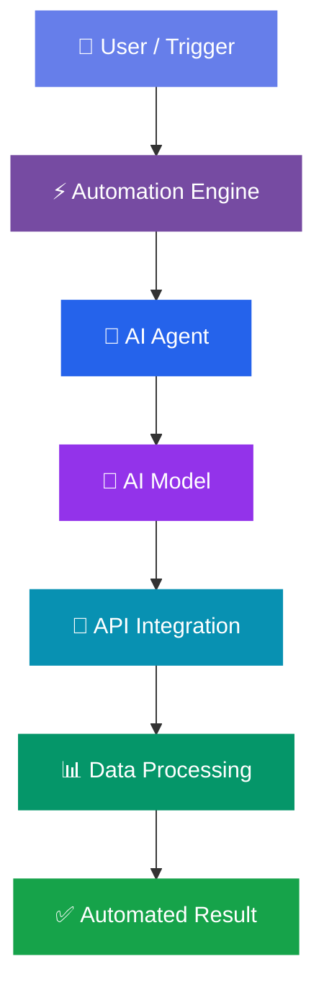

 

  

---

# 👩‍💻 About Me

Hi! Welcome to **Saleha AI Studio** 👋

I'm an **AI Automation Developer** passionate about creating intelligent AI agents, powerful automation workflows, and innovative AI-powered solutions.

I work with modern automation platforms to transform complex and repetitive tasks into smart, efficient systems.

### 🚀 My Focus

- 🤖 AI Agent Development
- 🧠 Intelligent Multi-Agent Systems
- ⚡ Workflow Automation
- 🔗 API Integration
- 📊 Business Process Automation
- 📧 Email & CRM Automation
- 🌐 AI-Powered Digital Solutions

---

# 🛠️ My Technology Stack

### ⚡ Automation Platforms

### 🧠 Artificial Intelligence

### 🔗 Integrations

---

# 🤖 What I Build

<table>
<tr>
<td width="50%">

### 🧠 Intelligent AI Agents

AI-powered agents designed to automate tasks, process information, and support intelligent workflows.

</td>
<td width="50%">

### ⚡ Workflow Automation

Automated workflows built with n8n, Zapier, and other automation platforms.

</td>
</tr>

<tr>
<td width="50%">

### 📊 Business Automation

Automation systems for lead management, CRM operations, and business processes.

</td>
<td width="50%">

### 🔗 API Integrations

Connecting applications, AI services, and external platforms through APIs and webhooks.

</td>
</tr>
</table>

---

# 🚀 Featured Projects

Explore my automation projects and AI-powered solutions.

| Project | Description | Technology |
|---------|-------------|------------|
| 🤖 AI Agents | Intelligent task automation | AI & APIs |
| ⚡ n8n Automation | Smart workflow automation | n8n |
| 🔥 Zapier Automation | Automated business processes | Zapier |
| 📊 SaaS Lead Automation | Lead management automation | Zapier & OpenAI |
| 📧 Email Automation | Automated email processing | AI & Gmail |
| 🧠 Multi-Agent Systems | AI agents working together | AI Integration |

---

# 🔄 My Automation Architecture

---

# 📈 GitHub Statistics

---

# 🎯 My Mission

### "Building Smarter Systems Through AI Automation"

My mission is to explore the power of artificial intelligence and automation to create innovative solutions that simplify work and improve productivity.

**Learn • Build • Automate • Innovate**

---

# 🌐 Connect With Me

---

### 💜 Thanks for Visiting Saleha AI Studio!

 

